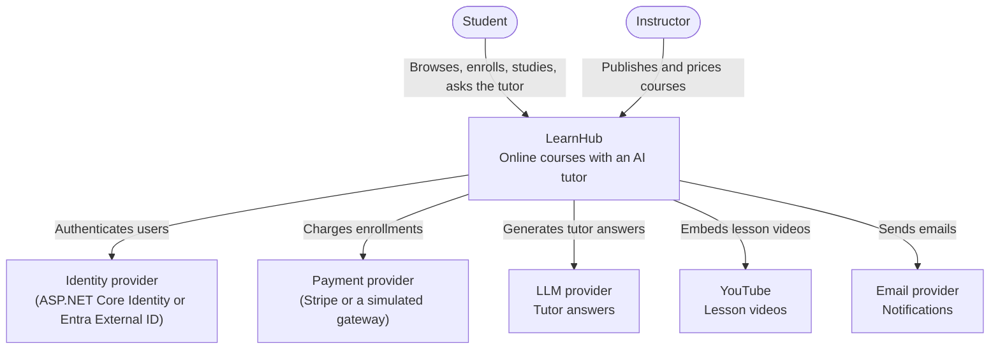
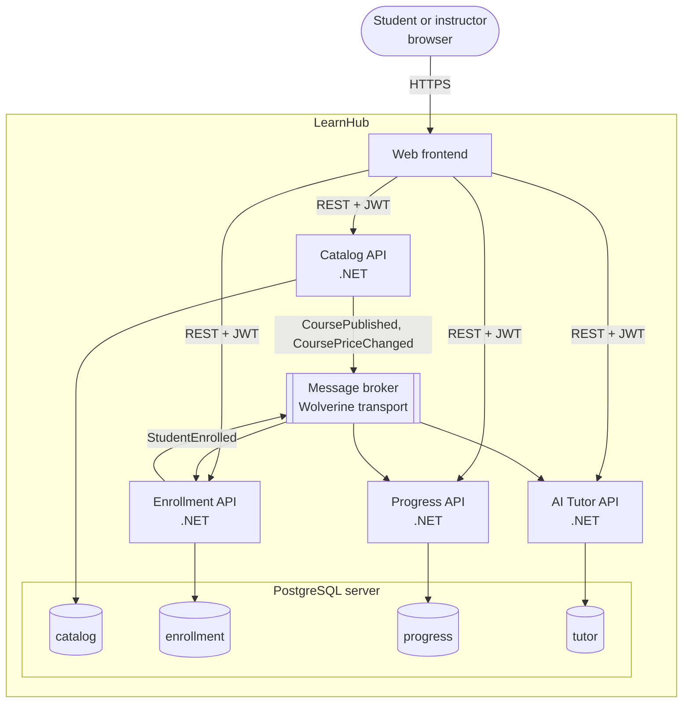

# C4 model

The [C4 model](https://c4model.com) describes a system at four zoom levels: context, containers, components, and code. LearnHub documents the first two; components and code are better read in the repository itself.

## Level 1: System context

Who uses LearnHub and which external systems it depends on.

## Level 2: Containers

The deployable units inside LearnHub and how they communicate ([ADR 0002](adr/0002-microservices-with-a-database-per-service.md), [ADR 0006](adr/0006-asynchronous-messaging-by-default.md)).

Only the Catalog API exists today; the other containers are the target and are added module by module. The frontend technology and the message broker are not decided yet; they will get their own ADRs.
