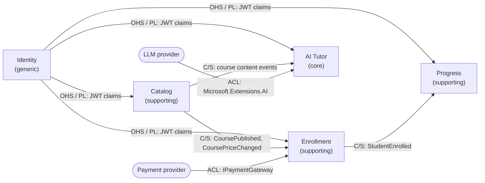

# Context map

LearnHub is split by business capability, not by entity or technical layer. Each bounded context owns its model, its language, and its data. Services are cut along these boundaries: a service never splits a context in two.

## Subdomains

| Subdomain | Type | Strategy |
|---|---|---|
| AI Tutor | Core | What differentiates LearnHub. Best design effort, rich domain model |
| Catalog (course authoring and publishing) | Supporting | Moderately rich domain: publishing has rules |
| Enrollment | Supporting | Real business rules: no duplicate enrollments, price frozen at enrollment time |
| Progress | Supporting | Kept simple |
| Identity | Generic | Do not build: use ASP.NET Core Identity or Microsoft Entra External ID |
| Payments | Generic | External provider (Stripe or a simulated gateway) |
| Video hosting, email | Generic | Azure Blob Storage and an email provider |

Generic subdomains get the thinnest possible integration. Effort goes to the core.

## Bounded contexts and their language

The same word means different things in different contexts. Contexts share identifiers, never classes.

| Context | "Course" means | "Person" is a |
|---|---|---|
| Catalog | Title, description, price, curriculum (sections and lessons), instructor, status | Instructor |
| Enrollment | Something a student enrolls in: ID and the price paid | Student |
| Progress | Lessons to complete and a completion percentage | Learner |
| AI Tutor | Chunked, indexed content used to answer questions | Learner |
| Identity | Not modeled | User (credentials, roles) |

## Relationships

Arrows point from upstream to downstream. OHS = Open Host Service, PL = Published Language, C/S = Customer/Supplier, ACL = Anticorruption Layer.

| Upstream → Downstream | Pattern | Integration |
|---|---|---|
| Identity → every context | Open Host Service + Published Language | JWT claims (`sub`, roles) |
| Catalog → Enrollment | Customer/Supplier | Events; Enrollment keeps a local copy of what it needs |
| Catalog → AI Tutor | Customer/Supplier | Content events; the tutor indexes content as embeddings |
| Enrollment → Progress | Customer/Supplier | `StudentEnrolled` event |
| Payment provider → Enrollment | Anticorruption Layer | `IPaymentGateway` adapter |
| LLM provider → AI Tutor | Anticorruption Layer | `Microsoft.Extensions.AI` abstractions |

## Rules

- Contexts integrate through events by default and keep local copies of the data they need. Synchronous calls between services are the exception.
- No context reads another context's database.
- `LearnHub.SharedKernel` is a technical shared kernel only (`Entity`, `ValueObject`, `Result`). Business concepts and DTOs never go there.
- If two contexts always change together, the boundary is wrong: merge them.
