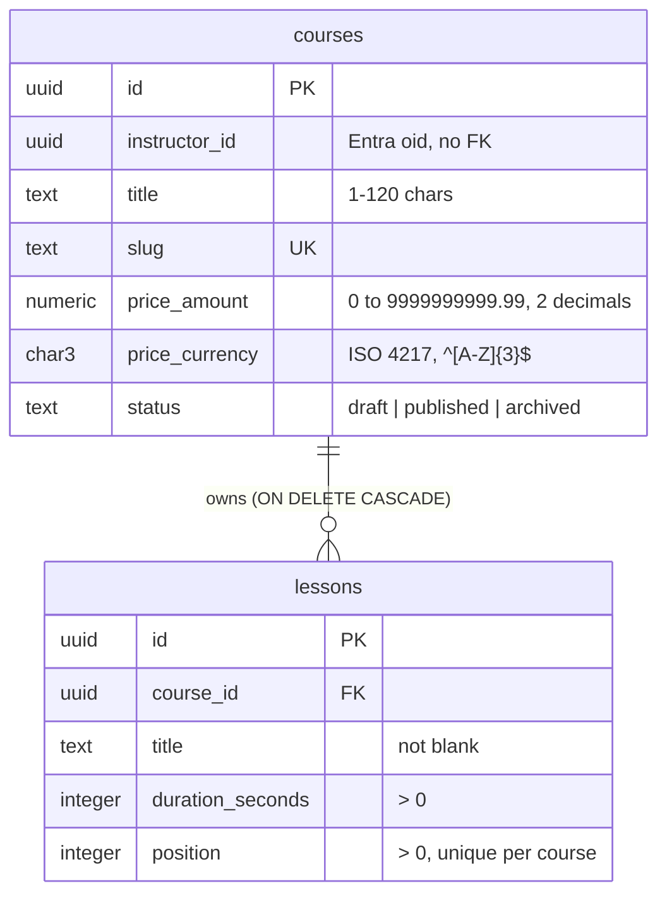

# Data model

Each service owns its database on one shared PostgreSQL server ([ADR 0002](adr/0002-microservices-with-a-database-per-service.md)). This document records each database's tables, their normal form, and the data deliberately left out. The schema itself is the source of truth; this explains why it looks the way it does.

## Catalog

Schema: [`001_create_courses_and_lessons.sql`](../../src/Services/Catalog/LearnHub.Catalog.Infrastructure/Persistence/Schema/001_create_courses_and_lessons.sql), with its constraints tested against a real server in `LearnHub.Catalog.Infrastructure.Tests`.

The `Course` aggregate spans two tables: a course owns its lessons, and lessons have no life outside it.

### Normal form

Both tables are in BCNF: every determinant is a candidate key.

| Table | Candidate keys | Functional dependencies |
|---|---|---|
| `courses` | `id` (primary), `slug` (`uq_courses_slug`) | `id → instructor_id, title, slug, price_amount, price_currency, status`; `slug → id` |
| `lessons` | `id` (primary), `(course_id, position)` (`uq_lessons_course_position`) | `id → course_id, title, duration_seconds, position`; `(course_id, position) → id` |

- The `Money` value object is flattened into `price_amount` and `price_currency`. That is one concept in two atomic columns, not a repeating group, so it keeps 1NF.
- Lesson order is stored in `position`, because tables have no order and the aggregate's list order is a fact.

### Data that is not stored

| Data | Why not | Where it comes from |
|---|---|---|
| Course total duration | Derived. A stored copy would be a second source of truth that every lesson change must update. | `SUM(duration_seconds)` per course, or `Course.TotalDuration` in the domain |
| Instructor name, email | Owned by the identity provider ([ADR 0009](adr/0009-delegated-authentication-with-entra-external-id.md)). A copy would go stale when the instructor changes it. | Entra External ID, keyed by `instructor_id` (the `oid` claim) |
| Lessons as a `jsonb` column | Lessons have identity, ordering and invariants that need a foreign key, `UNIQUE` and `CHECK` constraints, and they are queried on their own. | `lessons` table |

### Denormalization rule

Catalog stores no duplicated or precomputed data. Before any is added:

1. Measure first: the slow read must show up in `EXPLAIN ANALYZE`, and indexes and query changes must not fix it.
2. Name who keeps the copy in sync: a trigger, a materialized view refresh, or an event handler for a read model.
3. State how stale the copy may get.

A generated column (`GENERATED ALWAYS AS ... STORED`) cannot hold the total duration, because it can only read its own row.

### Copies in other services

Other services never get a foreign key into Catalog (ADR 0002). They keep only what they need:

- **Historical facts are not copies.** Enrollment will store the price paid at enrollment time ([context map](context-map.md)). It is a different fact from Catalog's current price and must not change when the course price does.
- **Read copies are denormalization across services.** If Enrollment keeps a course title to display it, Catalog events (`CoursePublished`, `CoursePriceChanged`) keep it updated, with eventual consistency.
