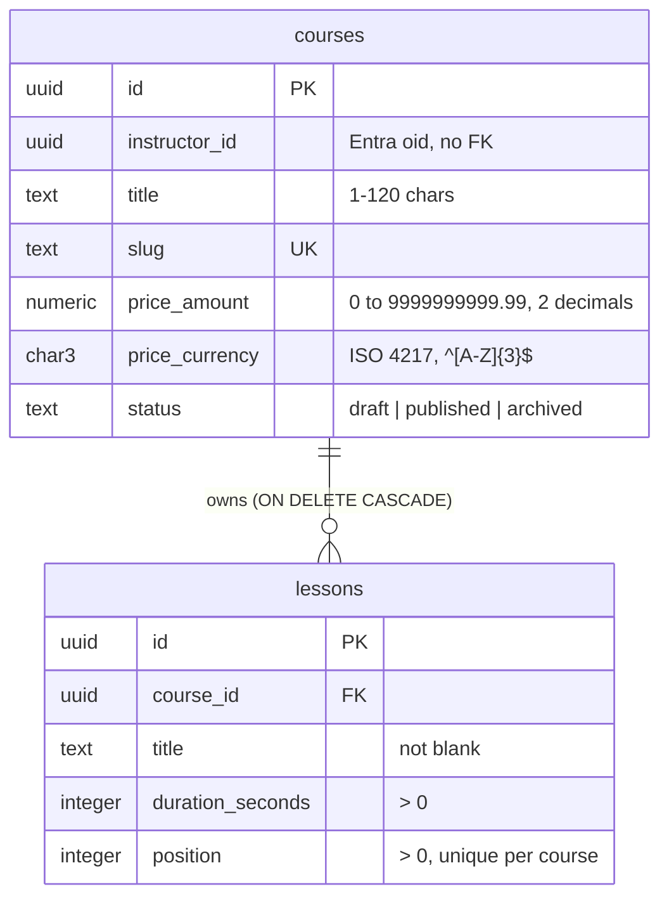

# Data model

Each service owns its database on one shared PostgreSQL server ([ADR 0002](adr/0002-microservices-with-a-database-per-service.md)). This document records each database's tables, their normal form, and the data deliberately left out. The schema itself is the source of truth; this explains why it looks the way it does.

## Catalog

Schema: [`001_create_courses_and_lessons.sql`](../../src/Services/Catalog/LearnHub.Catalog.Infrastructure/Persistence/Schema/001_create_courses_and_lessons.sql), with its constraints tested against a real server in `LearnHub.Catalog.Infrastructure.Tests`.

The `Course` aggregate spans two tables: a course owns its lessons, and lessons have no life outside it.

### Normal form

Both tables are in BCNF: every determinant is a candidate key.

| Table | Candidate keys | Functional dependencies |
|---|---|---|
| `courses` | `id` (primary), `slug` (`uq_courses_slug`) | `id → instructor_id, title, slug, price_amount, price_currency, status`; `slug → id` |
| `lessons` | `id` (primary), `(course_id, position)` (`uq_lessons_course_position`) | `id → course_id, title, duration_seconds, position`; `(course_id, position) → id` |

- The `Money` value object is flattened into `price_amount` and `price_currency`. That is one concept in two atomic columns, not a repeating group, so it keeps 1NF.
- Lesson order is stored in `position`, because tables have no order and the aggregate's list order is a fact.

### Data that is not stored

| Data | Why not | Where it comes from |
|---|---|---|
| Course total duration | Derived. A stored copy would be a second source of truth that every lesson change must update. | `SUM(duration_seconds)` per course, or `Course.TotalDuration` in the domain |
| Instructor name, email | Owned by the identity provider ([ADR 0009](adr/0009-delegated-authentication-with-entra-external-id.md)). A copy would go stale when the instructor changes it. | Entra External ID, keyed by `instructor_id` (the `oid` claim) |
| Lessons as a `jsonb` column | Lessons have identity, ordering and invariants that need a foreign key, `UNIQUE` and `CHECK` constraints, and they are queried on their own. | `lessons` table |

### Read queries

The derived data is computed at read time by versioned SQL in [`Persistence/Queries/`](../../src/Services/Catalog/LearnHub.Catalog.Infrastructure/Persistence/Queries/), tested in `CatalogQueriesTests`, `CatalogWindowQueriesTests` and `CatalogPaginationQueriesTests`:

| Query | Returns | Order |
|---|---|---|
| `list_published_courses.sql` | Published courses with `lesson_count` and `total_duration_seconds` | `title`, then `slug` |
| `list_published_courses_first_page.sql`, `list_published_courses_next_page.sql` | The same rows one page at a time (keyset pagination): the next page starts after the previous page's last `(title, slug)` | `title`, then `slug` |
| `list_instructor_courses.sql` | One instructor's courses in every status, with the same totals | `title`, then `slug` |
| `get_published_course_outline.sql` | One published course's lessons with `start_offset_seconds`, `percentage_of_course` (one decimal) and the course total; empty for a draft, archived or unknown course | `position` |
| `list_longest_published_courses_per_instructor.sql` | Up to three published courses per instructor by total duration, with their `rank` | `instructor_id`, then `rank` (ties broken by `slug`) |

- A course without lessons is kept by the `LEFT JOIN` and gets `0` lessons and `0` seconds: `count(l.id)` ignores the missing lesson where `count(*)` would count the course row, and `coalesce` turns the `NULL` of an empty `sum` into `0`.
- Both totals are `bigint`.
- `title` is not unique, so `slug` breaks ties; without it, rows with the same title have no defined order.
- The outline and the ranking use window functions, which keep one row per lesson or course. The percentage is computed as `numeric` (integer division would truncate) and rounded half away from zero by PostgreSQL's `round`, which differs from .NET's default `Math.Round` (half to even).

### Indexes

Every index is justified by a query. The constraints in `001` create four; [`Schema/002`](../../src/Services/Catalog/LearnHub.Catalog.Infrastructure/Persistence/Schema/002_create_query_indexes.sql) adds two. `CatalogIndexesTests` pins the exact set.

| Index | Key | Serves |
|---|---|---|
| `pk_courses` | `courses (id)` | Lookup by id, the outline's join to its course |
| `uq_courses_slug` | `courses (slug)` | Lookup by slug |
| `pk_lessons` | `lessons (id)` | Lookup by id |
| `uq_lessons_course_position` | `lessons (course_id, position)` | `fk_lessons_course` and its cascade, the outline, the lesson joins |
| `ix_courses_published_title_slug` | `courses (title, slug) WHERE status = 'published'` | The public listing and its pages |
| `ix_courses_instructor_title_slug` | `courses (instructor_id, title, slug)` | The instructor's courses |

- PostgreSQL does not index a foreign key column by itself. `lessons.course_id` needs no index of its own because `uq_lessons_course_position` starts with it.
- The partial index is usable only by queries that repeat `status = 'published'` as a literal.
- Pages use keyset pagination, not `OFFSET`: the cursor is the whole sort key `(title, slug)`, since a title alone would skip courses sharing the last row's title. The page of courses is chosen before its lessons are aggregated.
- Not created: an index on `status` alone (three values), a separate one on `lessons (course_id)`, duplicates of the constraint indexes, and `lower(slug)` (slugs are case-sensitive today).
- Whether the planner uses them is measured, not assumed. `CatalogQueryPlansTests` loads 100,000 courses (10% published) with five lessons each, runs `ANALYZE`, and reads `EXPLAIN (FORMAT JSON)` of each query. It checks the index and the condition that bounds it, never the whole plan shape:
  - the first page cuts a `Limit` over `ix_courses_published_title_slug` before looking up lessons;
  - the next page bounds that index with `ROW(title, slug) > ROW($1, $2)`, also in a generic plan, because `status = 'published'` is a literal;
  - the instructor listing is bounded by `ix_courses_instructor_title_slug`;
  - the outline goes through `pk_courses` and `uq_lessons_course_position`.
- Measured on that data (`EXPLAIN (ANALYZE, BUFFERS)`, PostgreSQL 18.3), a 20-course page read 115 buffers, while the unpaginated listing with `LIMIT 20 OFFSET 5000` read 6,093: it aggregates every published course before cutting.
- With a few rows a sequential scan is the cheapest plan, so plans are only read on a loaded database.
- In production, a plain `CREATE INDEX` blocks writes to the table while it builds.

### Transactions and concurrency

Catalog has no SQL writes yet (the repository arrives in module 6), so this is the contract that repository must keep. One aggregate is saved in one transaction, at PostgreSQL's default `READ COMMITTED`; the isolation level is raised only for a rule that needs it. Transactions stay short: no HTTP call and no user wait inside one. They never cross services (ADR 0002).

| Operation | Risk | Protection |
|---|---|---|
| `Course.AddLesson` | Two requests compute the same next position | `uq_lessons_course_position`: the second insert waits for the first and fails with `23505` when it commits; report a conflict or recompute |
| `Course.ChangePrice` | Lost update: the new price is an absolute value, so `price = price + n` does not apply | Optimistic version check, added with the module 4 ETag |
| `Course.Publish`, `Course.Archive` | The decision is taken on a loaded aggregate that may be stale | Same version check |
| A rule across rows (none today, for example a maximum of drafts per instructor) | Write skew: no single row to lock and no constraint can express it | `SERIALIZABLE`, retrying the whole transaction on `40001` |

`CatalogConcurrencyTests` pins this behavior with two real connections on PostgreSQL 18.3:

- `READ COMMITTED` loses the first update of a read, calculate and write, without any error.
- `SET price_amount = price_amount + n` and `SELECT ... FOR UPDATE` keep both changes: the second session waits and works on the first one's committed value.
- `REPEATABLE READ` rejects the second writer with `40001`. Its snapshot is taken at the first statement, not at `BEGIN`.
- Write skew passes `REPEATABLE READ` and `SERIALIZABLE` rejects it. The retry starts over and counts again, because retrying only the last statement would reuse a stale decision.
- Readers never wait for writers: they see the last committed row version until the writer commits.

An isolation level above `READ COMMITTED` is only safe with a retry: without one, it turns a silent bug into an error for the user. The read and the write must also share the transaction, since a read in its own transaction has a snapshot of its own.

### Denormalization rule

Catalog stores no duplicated or precomputed data. Before any is added:

1. Measure first: the slow read must show up in `EXPLAIN ANALYZE`, and indexes and query changes must not fix it.
2. Name who keeps the copy in sync: a trigger, a materialized view refresh, or an event handler for a read model.
3. State how stale the copy may get.

A generated column (`GENERATED ALWAYS AS ... STORED`) cannot hold the total duration, because it can only read its own row.

### Copies in other services

Other services never get a foreign key into Catalog (ADR 0002). They keep only what they need:

- **Historical facts are not copies.** Enrollment will store the price paid at enrollment time ([context map](context-map.md)). It is a different fact from Catalog's current price and must not change when the course price does.
- **Read copies are denormalization across services.** If Enrollment keeps a course title to display it, Catalog events (`CoursePublished`, `CoursePriceChanged`) keep it updated, with eventual consistency.
